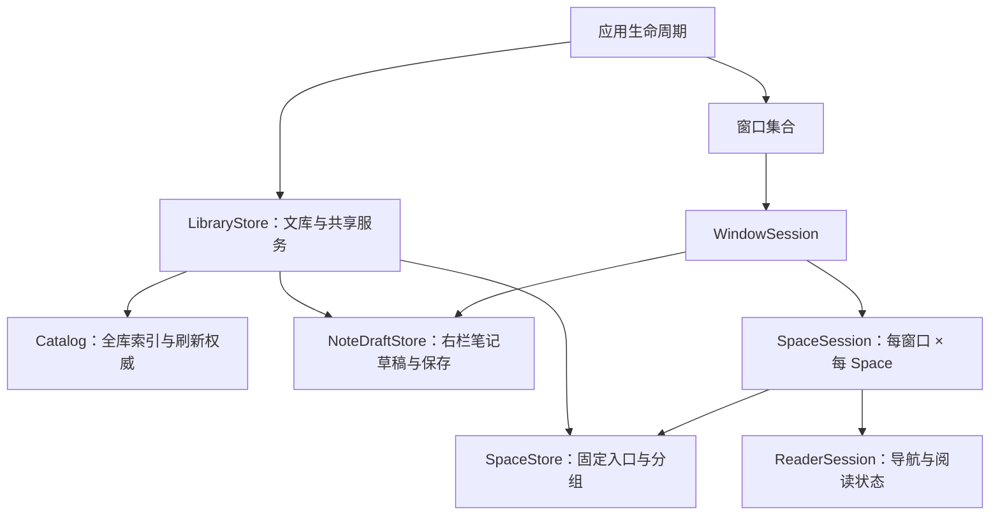

# Marple 多窗口与会话模型设计

状态：已实现于分支 `multi-window`（未提交）；GUI 交互待手动验收。2026-11-08 按代码核对修订：浏览条件归窗口、文档编辑范围收窄为右栏笔记草稿、撤销路由、CLI 组织命令、窗口位置、阶段顺序。

依据：[YAB / Ulysses 逆向研究](multi-window-research.md)。本文将研究结果收敛为 Marple 的产品行为与数据契约，不代表对方源码。

## 1. 核心决定

**一份资料库、一份 Space 组织结构、多个独立窗口会话。**

同一 Space 可以同时在任意窗口打开。共享固定页面及分组，独立选择、导航、搜索、滚动与临时页面。不采用 Space 独占窗口，不复制整套资料库或索引。

四种概念分开：

| 概念 | 含义 | 生命周期 |
| --- | --- | --- |
| Document | 文档内容与元数据 | 跟随文库 |
| SpaceItem | Space 中保存的固定入口、别名及位置 | 用户显式移除前一直存在 |
| ReaderSession | 从某个入口出发的一次阅读，包括当前位置与历史 | 跟随窗口会话 |
| WindowSession | 当前 Space、各 Space 的会话、窗口布局 | 可关闭、可恢复 |

**固定入口是引用，阅读会话是状态，窗口是容器。** 关闭窗口不删除 Space；从固定入口跟链接到别处，不改入口的锚点，也不影响另一个窗口。

本次调整应用内模型与会话存档，不改 vault 正文格式，不给文库中每篇文件批量补 UUID。

## 2. 从成熟应用借鉴什么

- **YAB**：Space 定义与「窗口 × Space」会话分别保存；标签身份可以共享，窗口选择独立；固定入口的 `home` 与当前 `url` 分开。
- **Ulysses**：应用持有存储服务，窗口持有界面与选择，编辑器持有历史及阅读位置；窗口或分屏复用资料模型。
- **Marple 的取舍**：保持现有侧栏文档页面与三栏 UI；首版不增加 Ulysses 式顶部原生窗口标签，不增加 YAB 式“临时页面是否共享”的设置。

未验证的对方导航同步、草稿共享和冲突算法，不作为设计前提。

## 3. 状态归属



| 状态 | 所属对象 |
| --- | --- |
| client、索引器、watcher、备份、CLI、语义索引服务 | 应用级 Library，只启动一次 |
| entries、关系图、全库搜索索引、唯一刷新调度 | 共享 Catalog |
| Space 名称、图标、归档、固定入口、分组及顺序 | Library 中的共享 Space 定义 |
| 保存的视图定义、类型顺序与隐藏、回收站、档案集合 | 应用级共享状态 |
| 当前 Space、窗口位置、侧栏显隐 | WindowSession |
| 浏览面板、搜索、筛选排序、列表显示方式 | WindowSession（与现状一致：跨 Space 保持，切 Space 清空搜索） |
| 当前页面、浏览/阅读模式、临时页面、折叠状态 | SpaceSession |
| 可见列表、列表匹配结果、列表计算任务 | 窗口的 CatalogViewport |
| 当前文档位置、前后退历史、滚动、附件预览、播放 | ReaderSession / 窗口运行时 |
| 打开文档的目录、统计、关系等派生结果 | 窗口的 CatalogViewport |
| 右栏笔记的草稿、基线、保存状态与保存任务 | NoteDraftStore，按路径唯一，多窗口引用计数 |

名称表示责任边界，不要求每个框都变成新类或新 target。保留 `AppModel` 作为窗口视图的 facade：共享状态以转发属性读写 Library（沿用 `entries { catalog.entries }` 的写法），避免一次改写全部视图。

主阅读视图只读（`MarkdownTextView` 的 `isEditable = false`），可编辑正文只有右栏笔记，因此“文档存储”收窄为笔记草稿存储。

## 4. 数据模型

以下为结构示意，字段类型在实现时复用已有 `NavLocation`、`NavHistory`、筛选及布局类型。

```text
SpaceDefinition
  id: SpaceID
  name, icon, archived
  roots: [SpaceNode]                    // 有序分组树，仅含固定入口

SpaceNode
  group(id: GroupID, name, children)
  item(id: ItemID, homeLocation, customTitle?, cachedTitle?, cachedType?)

WindowSession
  id: WindowID
  activeSpaceID: SpaceID
  layout: WindowLayout
  spaces: [SpaceID: SpaceSession]

WindowSession（续）
  browseState: BrowseState              // 面板、筛选排序、显示方式；窗口级

SpaceSession
  activeReaderID: ReaderID?
  mode: browsing | reading
  collapsedGroupIDs: Set<GroupID>
  readers: [ReaderID: ReaderSession]
  temporaryOrder: [ReaderID]             // 固定入口顺序来自共享树

ReaderSession
  id: ReaderID
  sourceItemID: ItemID?                  // nil 表示临时页面
  history: NavHistory                   // current 是唯一当前位置来源
  derivedState / loadTask / generation  // 运行时，不保存
```

### 实现映射

不新建平行的 reader 类型，复用现有 `Workspace`：

- 每个窗口为每个 Space 持有一份自己的 `Workspace` 值，即该窗口的 SpaceSession。其中固定标签的 `NavTab.id` 就是 ItemID，`history` 是本窗口的 ReaderSession；临时标签是临时 reader；`TabGroup.isCollapsed` 是本窗口的折叠状态。
- 共享定义 `SpaceDefinition` 从 `Workspace` 中抽取：固定标签（ID、锚点、别名、缓存标题/类型）与分组（ID、名称、子节点），不含历史、选择、临时页、折叠。
- 某窗口改动组织结构后抽取定义并发布到 Library；Library 把新定义 rebase 进其他窗口的 `Workspace`：按 ID 保留它们的历史与选择，保留临时页与折叠状态；新入口以锚点创建；被移除的入口若本窗口已离开锚点或正在显示，则转为临时页（换新 ID，避免同窗口跨 Space 撞 ID），否则直接移除。
- 因此“未打开的固定入口”在实现上是停在锚点的标签，不额外区分。

身份规则：

1. `ItemID` 与 `ReaderID` 不同；同一固定入口可以在两个窗口拥有不同 ReaderSession。
2. 每个 SpaceSession 中，一个 ItemID 最多关联一个 ReaderSession，点击已有入口会选中它；未打开的固定入口不需要预先创建 reader。
3. 同一文档可以有多个固定入口或临时页面，不能用文档路径代替 ItemID 或 ReaderID。
4. `GroupID`、`ItemID` 跨重启稳定；树引用不依赖标签数组下标。
5. 文档键沿用相对路径。应用内移动（档案集合移动）统一重映射所有窗口的入口、历史与草稿；外部无法识别的移动按删除与新增处理，保留失效入口供用户处理。
6. 分组折叠状态属于 SpaceSession，不再写在共享分组结构里。

`NavLocation` 中已有的列表上下文可继续用于恢复导航，不为了多窗口另外重设计历史语义。恢复列表上下文时只更新当前 SpaceSession。

## 5. 窗口与页面行为

### 创建、切换与关闭窗口

- `⌘⇧N` 新建完整三栏窗口，进入来源窗口当前 Space；复制其浏览条件作为初始值，之后独立。首次进入浏览模式，不复制临时页面或历史。
- 文档菜单「在新窗口打开」创建窗口并打开该文档。若来自固定入口，新 reader 关联同一个 ItemID；否则创建临时 reader。
- 所有窗口都可切换到任意未归档 Space。返回之前访问过的 Space 时，恢复这个窗口自己的 SpaceSession。
- 关闭窗口释放窗口资源并保存可重开快照，不删除 Space、固定入口或文档。
- 关闭最后一个窗口后应用保持运行（现状为退出，属有意变更）；点击 Dock 或「新建窗口」重新打开。显式退出时停止服务。
- 退出重启恢复退出时仍打开的窗口；已关闭窗口不自动复活。只保留一个最近关闭窗口，供 Dock 重开时恢复；首版不加「重新打开关闭的窗口」菜单。
- 窗口位置存入各自的 WindowSession（`NSWindow.frameDescriptor`），新窗口错位摆放；不再使用单一的 `MarpleMainWindow` 自动保存名。

### 固定入口与临时页面

| 操作 | 作用范围 |
| --- | --- |
| 新开临时页面、关闭临时页面 | 当前窗口当前 Space |
| 选择页面、跟链接、前进后退、搜索 | 当前窗口 |
| 重命名固定入口、重排或移动分组 | 所有窗口共享 |
| 折叠分组 | 当前窗口当前 Space |
| 固定临时页面 | 创建共享 ItemID；当前 reader 关联它；其他窗口只增加入口 |
| 取消固定或显式移除固定入口 | 删除共享入口；已有 reader 转为临时页面，保留位置和历史 |

跨 Space 移动固定入口保留 ItemID；来源 Space 中已有 reader 转为临时页面，不强制其他窗口切 Space。目标 Space 的入口按需创建新的 reader。

沿用现有锚点语义：`⌘W` 在固定页面上返回 `homeLocation`，已在锚点则不操作；临时页面则关闭。浏览模式或没有活动 reader 时关闭当前窗口。`⌘⇧W` 始终关闭当前窗口。显式移除固定入口与关闭窗口不是同一操作。

归档 Space 后隐藏其入口，正在显示它的窗口切到可用 Space，保留可恢复会话。删除 Space 与现状一致：各窗口中正在显示它的回落到可用 Space；没有可用 Space 则创建默认 Space。

CLI 组织命令（`tabs.list/rename/move`、`folders.*`）：固定入口按 ItemID 作用于共享定义（ID 从此跨重启稳定）；临时页取最前面的主窗口。把临时页移入文件夹仍会固定它，与现状一致。

## 6. 笔记编辑、刷新与撤销

可编辑的只有右栏笔记。现有草稿本就按路径存放（`inspectorNote*` 字典），多窗口只把它移到应用级 NoteDraftStore：

- 同一笔记在两个窗口打开时共用同一份草稿、基线、状态和保存任务，光标和滚动各自独立。不加占用锁，也不会出现两份窗口私有草稿互相覆盖。
- 每个窗口登记自己正在显示的笔记路径；窗口切换文档或关闭时注销。只有无人引用且已保存的条目才被丢弃，dirty 条目保留到保存完成。退出时刷新全部草稿。
- 外部修改冲突检测（保存前比较基线）是单窗口就存在的问题，不在多窗口首版范围内，另行处理。

撤销：

- 组织操作（侧栏结构、类型顺序、视图）进应用级撤销栈，所有窗口返回同一个 UndoManager。所有修改共享定义的操作都登记在这一栈上，按后进先出顺序回放，因此沿用现有“快照还原”实现即可，不需要改写为按 ID 的逆操作。窗口关闭时移除以它为目标的撤销项。
- 笔记编辑器通过 `undoManager(for:)` 使用每个编辑器自己的 UndoManager，不再与侧栏共用窗口撤销栈；首版不做跨窗口共享的文本撤销。
- 导航历史按 reader 独立，不进入撤销栈。

Catalog 保留唯一全库刷新权威。一次文库刷新发布共享快照，各窗口只重算自己的列表与打开文档派生结果：发布后的共享反应（schema、本地化、回收站、存档）只做一次，按窗口的反应（可见列表、重载打开文档）逐个窗口执行。后台关系图算完时由共享 Catalog 通知已登记的各个视口刷新。窗口关闭取消窗口计算任务；关闭窗口不停止全库刷新。异步 reader 加载保留 generation 校验，旧结果不能覆盖新导航。

## 7. 命令路由

菜单、工具栏和搜索面板从发起窗口取得 WindowSession，不通过一个固定的全局 AppModel 执行。

- 没有显式目标时，默认目标是最前面的主窗口：参照 NetNewsWire，按 `NSWindow.orderedIndex` 现算，不在运行时另记“最近活动窗口”。
- CLI 与 `marple://` 的打开操作进入最前面的主窗口；没有窗口时创建一个。只读搜索与索引命令直接使用应用服务。
- 异步操作开始时捕获目标窗口，不因操作期间焦点变化而改写另一个窗口。
- 设置页、MemoryWatchdog、退出时刷新草稿访问 Library，不依赖某个窗口是否存在。

## 8. 持久化格式

沿用现有 `PersistedState`（同一 UserDefaults 键、同一容错解码、同一备份与“读不懂则不覆盖”保护），原地扩展，不另起新键：

```text
PersistedState
  spaces: [PersistedWorkspaceSpace]     // 共享定义：只含固定标签（带 id）与分组树（带 id）
  savedViews / counts
  windows: [PersistedWindow]?           // 新增；nil 表示旧存档，需迁移
  recentlyClosedWindow: PersistedWindow?
  （旧顶层字段 browsePane/tabs/activeIndex… 继续由最前窗口写出，供旧版本降级读取）

PersistedWindow
  id, frame, activeSpaceID
  browsePane, sortClauses, filterClauses, filterMatch, browseMode
  spaces: [PersistedSpaceSession]

PersistedSpaceSession
  spaceID, isBrowsing, activeTabID
  temporaryTabs: [PersistedTab]         // 带 id
  pinnedLocations: [id: NavLocation]    // 仅记录离开锚点的固定页当前位置
  collapsedGroupIDs
```

首版不保存完整前后退栈，与现有行为一致。新增一点：固定页离开锚点时保存当前位置，重启后回到原处；锚点仍在共享定义中，`⌘W` 照旧回锚点。

旧版本读取新存档时，会得到全部 Space、固定入口和分组，但看不到临时页；这是可接受的降级。正文、草稿内容、索引、渲染缓存、Task、UndoManager 不进入存档。Library 是唯一写者，关闭窗口和正常退出前写入。

### 旧存档迁移

1. 通过现有容错解码读取旧存档；损坏且禁止保存的旧状态继续禁止覆盖。
2. Space ID 原样保留；固定标签成为共享入口，保留锚点、别名、缓存和分组顺序；缺失的 ItemID / GroupID 在读取时生成，首次保存后固定。
3. 原数组下标树按现有映射转换；不按路径合并重复入口。
4. 旧活动 Space、标签选择、临时页面和浏览条件迁入第一个窗口；旧分组折叠值作为该窗口的折叠状态。
5. 旧存档未保存完整历史，不尝试恢复不存在的数据。

## 9. iPhone 会话输出

Mac 内部存档与 `session/open-tabs.json` 是两种格式。前者完整恢复窗口，后者是面向手机的只读投影。

首版维持现有 v3 输出，仍按 Space 展示，不要求手机同步增加窗口 UI：

- 固定入口与分组树取自共享定义，保留别名及不同位置的重复引用。
- 在 Space 树末尾追加所有打开窗口的临时文档；按文档路径去重，已有固定入口指向该路径时不重复追加。
- 临时页标题取最近使用实例，排序采用稳定的首次汇总顺序，避免窗口切焦点导致整列跳动。
- `activePath` 取该 Space 最近使用的打开窗口会话；无有效 reader 则 nil。
- 分组展开状态在输出中统一为展开，避免任意 Mac 窗口折叠改变手机组织显示。
- 已归档 Space 不输出；recentClosedWindow 不加入当前打开集合。窗口关闭后重新汇总；退出不额外清空最后一次有效快照。

只有一个 SessionWriter 负责发布。实施后需要验证现有 iOS 解码与展示，并按仓库要求重新安装、启动 Mac 应用，使运行实例使用新 writer。

## 10. 实施顺序与代码落点

| 阶段 | 主要修改 | 完成标准 |
| --- | --- | --- |
| 1. 拆导航模型 | `Navigation.swift`、`PersistedState.swift`：共享定义抽取、rebase、带 ID 的新存档字段与迁移 | 单窗口交互不回退；迁移保留入口、分组和选择；新格式在本阶段落地，只写一个窗口 |
| 2. 拆状态所有权 | `Library` 取代 `AppState` 的服务部分；`AppModel` 作为窗口 facade；拆出 `CatalogViewport`；NoteDraftStore | 同一资料库只有一个刷新/保存权威，窗口状态可独立构造 |
| 3. 加窗口与路由 | AppDelegate 窗口集合、⌘⇧N、TabCommands / CLI / URL 路由、撤销路由、窗口位置 | 同 Space 双窗口独立导航，共享组织结构，关闭不串窗口 |
| 4. 恢复与同步 | 多窗口存档与恢复、最后窗口关闭与 Dock 重开、SessionWriter 汇总 | 重启恢复、手机兼容、退出不丢草稿 |

新存档格式放在阶段 1：否则阶段 1–3 只能写回没有 ID 的旧 `PersistedTab`，ItemID 每次启动都会重新生成，还要迁移两次。

L2 的派生逻辑仍放在 MarpleKit；将全库 Catalog 与按视口创建的派生状态分开，后者只接收快照/查询输入，不依赖 L4 的窗口或 Space 类型。macOS 继续负责 reconcile 编排、窗口生命周期和会话保存；iOS 只需适配派生状态接口，产品仍为只读。

这是对 `apple/ARCHITECTURE.md` 中“单一 Catalog 同时拥有全库与视口状态”的有意修订。实现相应阶段时更新架构地图，保持全库刷新单飞与平台边界，不复制索引器来规避拆分。

## 11. 验收与首版范围

必须通过的行为：

1. 两窗口同 Space，当前选择、搜索、跟链接、后退、折叠互不影响。
2. 固定入口重命名、重排、跨 Space 移动在所有窗口正确反映，不重置阅读历史。
3. 同一固定入口在两个窗口导航到不同文档，锚点保持不变；移除入口不丢正在阅读的内容。
4. 同一笔记两窗口编辑共享草稿，一个窗口切换文档或关闭不丢另一窗口的草稿；保存失败不静默丢失。
5. 窗口关闭、最后窗口关闭、Dock 重开、正常退出与重启的行为符合本文。
6. 旧存档迁移可重复启动，引用有效，读不懂的存档不被覆盖；不合并用户有意创建的重复入口。
7. 手机 v3 输出兼容、多窗口临时页正确汇总；索引、watcher、CLI 与 SessionWriter 均只有一套。

首版不做标签拖出/跨窗口拖放、顶部原生标签、分屏 UI、多资料库、完整历史持久化或跨设备窗口布局同步。模型为后续功能留出明确边界，但不提前实现它们。
